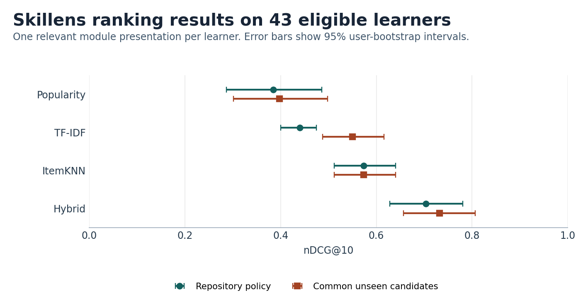

# Skillens

Skillens ranks learning content with text similarity, item co-occurrence and a weighted combination of the two. A Streamlit demo lets a visitor enter a goal and explore recommendations. The offline experiment asks a narrower question: how highly can each model rank an OULAD module-presentation a returning learner has not encountered in training?

## What the experiment found

The OULAD archive contains **10,655,280 activity rows from 26,074 learners**. Of the 25,797 learners with test records, **43 (0.167%)** had a previously unseen module-presentation. Each had one eligible item among 22 possible presentations. The table reports mean nDCG@10 for those 43.

| Ranking model | Original candidate policy | Common unseen candidates |
| --- | ---: | ---: |
| Popularity | 0.384 | 0.398 |
| TF-IDF | 0.440 | 0.550 |
| ItemKNN | 0.574 | 0.574 |
| Hybrid, 60% text and 40% collaborative | 0.703 | 0.732 |



Both ItemKNN and the hybrid recovered every eligible item in the top ten. The difference is in rank position. With the original policy, the hybrid's 95% bootstrap interval is 0.628 to 0.780. This experiment measures ranking for a small selected group. The catalogue demo uses separate data and has no measured learning-outcome effect. [Reproduce the experiment, compare candidate policies and inspect paired tests](evaluation/README.md)

## Try the demo

```bash
python -m pip install -r requirements.txt
python -m streamlit run src/app/app.py
```

Enter a learning goal, select a model and inspect its explanations. An optional guest name and feedback stay in the browser session. The demonstration catalogue includes external course titles alongside OULAD items. [Open the Streamlit demo](https://cm370-skillens-kuxgzkqtmag6eozssjk5s6.streamlit.app/)

## Explore the implementation

* [Data preparation](src/data) constructs module-presentation items and per-learner splits.
* [Ranking models](src/models) implement the popularity, text, item-based and hybrid baselines.
* [Evaluation](src/eval) includes ranking metrics, statistical tests, robustness checks and the original reporting pipeline.
* [Source history](PROVENANCE.md) distinguishes earlier reports from the reproduced comparison.

For the original reporting pipeline, place OULAD files in `data/raw/oulad/` and run `python -m src.eval.pipeline --prepare-data --data-mode oulad`. Use `--data-mode synthetic` for an explicitly labelled software fixture. The pipeline records the data mode and checks prepared-file hashes on reuse.
